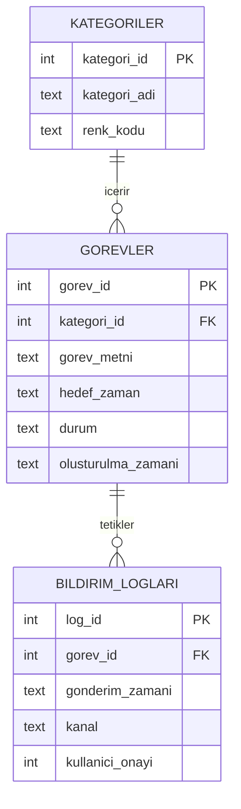

# phtyon-hatirlatici-proje
# Python Akıllı Hatırlatıcı Asistanı 
"Siz sadece planınızı yazın, gerisini o düşünsün."

# Proje Hakkında
Kullanıcıların günlük metinlerinden veya notlarından tarih, saat ve görev bilgilerini regex (Düzenli İfadeler)ve Doğal Dil İşleme (NLP) yöntemleriyle otomatik olarak çıkaran akıllı bir Python asistanıdır. 
Algılanan planlar, kullanıcı onayının ardından SQLite veritabanına kaydedilir ve zamanı geldiğinde proaktif olarak bildirim (masaüstü/Telegram) aracılığıyla hatırlatılır. Geleneksel takvim uygulamalarına manuel veri girme üşengeçliğini ortadan kaldırmayı hedefler.

# Temel Özellikler
* Akıllı Metin Analizi:Yazılan cümlelerin içindeki zaman ifadelerini (Örn: "Salı 14:00'te ders çalışacağım") arka planda tarar ve yakalar.
* Etkileşimli Onay Sistemi:Bir görev tespit edildiğinde anında bir pop-up arayüzü ile kullanıcıdan veri kayıt onayı alır.
* Kalıcı Depolama: Tüm onaylı görevler, durumları ve zaman damgalarıyla birlikte yerel bir SQLite veritabanında yapılandırılmış olarak tutulur.
* Proaktif Bildirim Sistemi: Görev vakti geldiğinde doğrudan kullanıcıya hatırlatma mesajı gönderir.

# Kullanılan Teknolojiler ve Mimari
* Ana Dil: Python 
* Yazılım Mimarisi: Nesne Yönelimli Programlama 
* Veritabanı Yönetimi:SQL
* Ayrıştırma Modülü: Regex 
* Arayüz (GUI):
* Zamanlama & Bildirim: APScheduler, Telegram Bot API

